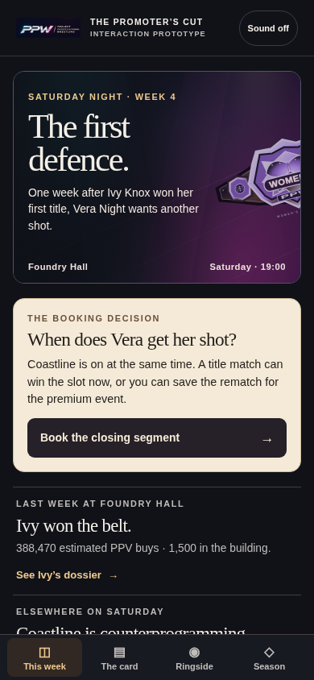
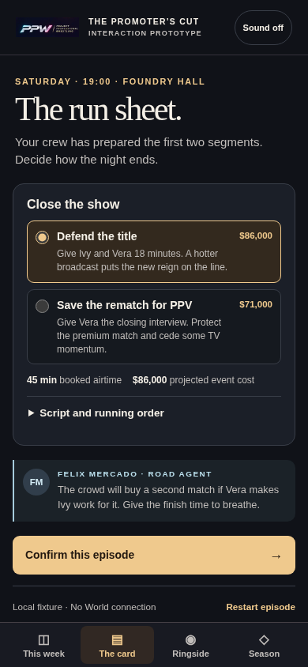
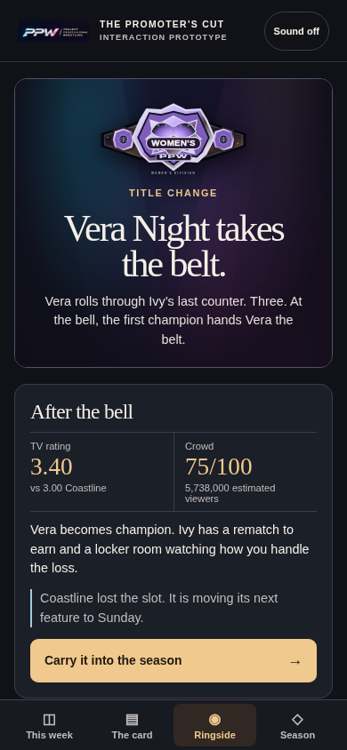
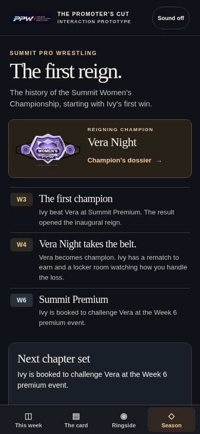

# The Promoter’s Cut

**An isolated PPW design prototype.** Book Saturday’s closing segment, watch the result and decide what goes into the next premium event. The title and audience can go different ways.

[Read the creative assessment and roadmap](ASSESSMENT.md) · [Watch the mobile click-through](evidence/mobile-journey.mp4)

## Run it

From the repository root, install the existing PPW dependencies if needed. The preview runs on the package’s existing Vite installation.

```sh
npm install --no-audit --no-fund
npm exec -- vite build --config prototypes/premium-ppw/vite.config.ts
npm exec -- vite preview --config prototypes/premium-ppw/vite.config.ts
```

Open `http://127.0.0.1:4181/`. The running preview uses a disposable fixture and local browser storage. It uses no World account, databases or external services. Start again with **Restart episode**.

- **Title-change path.** Open the run sheet, choose the title defence, expand **Script and running order**, and select **Vera wins by pinfall**. Confirm and choose **Ring the bell**. Reserve Ivy’s title challenge from the Season screen.
- **PPV path.** Restart and choose **Save the rematch for PPV**. Confirm and use **Skip to the result**. Ivy retains the belt and Coastline wins the audience. The season lets you resolve or leave open Vera’s televised challenge.

The preview uses the production ratings projection and existing PPW assets. Week 3 facts were observed and certified in the earlier disposable Milestone 7 run. Week 4 and its recorded local progression are an authored fixture. The Week 6 match is a local commitment marker.

## Mobile evidence

The files are browser screenshots of the running build. They use Chromium touch emulation, 390 × 844 or 320 × 744 CSS pixels, at 1× image scale. The recording is a live browser capture encoded as H.264.

| This week | The run sheet |
|---|---|
| [](evidence/01-week-390.png) | [](evidence/02-card-390.png) |
| [Before the bell](evidence/03-before-the-bell-390.png) | [320px alternate card](evidence/07-alternate-card-320.png) |

| Title change | Season |
|---|---|
| [](evidence/04-title-change-390.png) | [](evidence/05-season-390.png) |
| [320px alternate result](evidence/08-alternate-result-320.png) | [Champion’s dossier](evidence/06-dossier-390.png) |

## Verification

With the built preview running, use the existing Playwright setup. `PPW_CHROMIUM` selects an installed Chromium executable when available. Otherwise use the project’s Playwright browser installation.

```sh
npm exec -- tsc -p prototypes/premium-ppw/tsconfig.json
node prototypes/premium-ppw/verify.mjs
```

Set `PPW_PROTOTYPE_CAPTURE=1` to write PNGs and `PPW_PROTOTYPE_VIDEO=1` to record the principal path as WebM. Video recording uses Playwright-compatible FFmpeg. `PPW_PROTOTYPE_EVIDENCE` overrides the directory. The script checks both branches, local state persistence, reduced motion, keyboard focus, layout, assets and absence of API or third-party requests.

A shaped Chromium run at 390px with 120 ms latency, 200 KB/s down and 4× CPU throttling measured about **0.51 s LCP**, **0.61 s load** and **19.1 KB encoded response bodies** across four resources. These are lab measurements for the small fixture. Actual Safari, touch reach, accessibility and battery behaviour need device validation.
